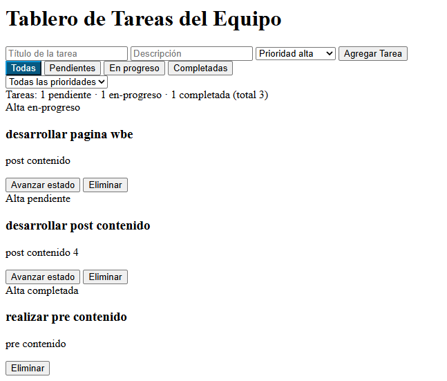
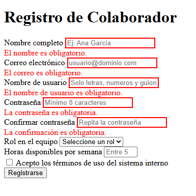

# Post-contenido — Unidad 4: JavaScript Básico

**Estudiante:** William Felipe Villamizar Soler  
**Código:** 1152498  
**Programa:** Ingeniería de Sistemas  
**Semestre:** Séptimo  
**Asignatura:** Programación Web

## Descripción

Este repositorio contiene el desarrollo del laboratorio de la
Unidad 4 de Programación Web, enfocado en JavaScript, manipulación
del DOM, eventos y validación de formularios.

El proyecto está dividido en dos partes:

- Parte 1: Tablero de tareas del equipo.
- Parte 2: Formulario de registro de colaborador.

Ambas aplicaciones utilizan HTML5, CSS3 y JavaScript puro,
sin librerías externas.

## Parte 1 — Tablero de tareas del equipo

Aplicación que permite administrar tareas de un equipo mediante
JavaScript y manipulación del DOM.

Funcionalidades implementadas:

- Agregar tareas con título, descripción y prioridad.
- Generar identificadores únicos mediante una closure.
- Avanzar tareas entre pendiente, en progreso y completada.
- Eliminar tareas mediante delegación de eventos.
- Filtrar tareas por estado y prioridad simultáneamente.
- Utilizar switch para configurar la apariencia por prioridad.
- Calcular estadísticas mediante reduce() y for...of.
- Actualizar únicamente los elementos necesarios del DOM.

Carpeta: `parte-1-tablero-tareas/`

## Parte 2 — Formulario de registro de colaborador

Formulario de registro con validación completa del lado del
cliente, utilizando JavaScript y la Constraint Validation API.

Funcionalidades implementadas:

- Validar nombre completo y correo electrónico.
- Validar nombre de usuario mediante patternMismatch.
- Comprobar los requisitos de seguridad de la contraseña.
- Confirmar la coincidencia de las contraseñas.
- Mostrar el campo Equipo a cargo únicamente para líderes.
- Validar horas disponibles mediante rangeUnderflow y
  rangeOverflow.
- Verificar la aceptación de términos mediante checked.
- Mostrar mensajes específicos de error por campo.
- Validar mediante eventos blur, change e input.
- Interceptar el evento submit con preventDefault().
- Mostrar un mensaje de registro exitoso.
- Restablecer el formulario después de dos segundos.
- Mostrar un indicador visual de fortaleza de contraseña.

Carpeta: `parte-2-formulario-colaborador/`

## Decisiones de diseño

### Parte 1 — Generador de ID

**Estrategia elegida: A — Closure.**

Se eligió una closure para mantener el contador de identificadores
encapsulado dentro de una función.

Esta estrategia evita que otras partes del programa puedan
modificar directamente el contador, lo que reduce el riesgo de
generar identificadores repetidos.

Aunque utilizar una variable global sería más sencillo, la
closure ofrece mejor organización y protección del estado.

### Parte 1 — Actualización del DOM al avanzar estado

**Estrategia elegida: A — Actualización dirigida.**

Se decidió modificar únicamente los elementos HTML de la tarea
cuyo estado cambia, en lugar de reconstruir todo el tablero.

Esta alternativa evita operaciones innecesarias sobre otras
tareas y permite conservar los elementos existentes.

Al agregar una tarea se incorpora directamente su elemento
al tablero y, al eliminarla, se remueve el elemento
correspondiente. Después se actualizan las estadísticas
y se aplican los filtros cuando es necesario.

La actualización dirigida resulta adecuada porque cada
operación afecta principalmente a una tarea.

### Parte 2 — Validación de contraseña

**Estrategia elegida: B — Validaciones independientes.**

Se eligieron comprobaciones independientes para verificar
la longitud mínima, las mayúsculas, los números y los
caracteres especiales.

Esta estrategia permite mostrar un mensaje diferente
para cada requisito incumplido.

Se prefirió frente a una expresión regular compuesta
porque un mensaje específico facilita que el usuario
identifique qué debe corregir.

Aunque requiere más condiciones, mejora la claridad
de la retroalimentación y facilita el mantenimiento.

### Parte 2 — Campo condicional Equipo a cargo

**Estrategia elegida: A — Alternar required nativo.**

Se eligió modificar dinámicamente el atributo required
del campo Equipo a cargo según el rol seleccionado.

Cuando el usuario selecciona Líder, el campo aparece
y se vuelve obligatorio. Si selecciona otro rol,
el campo se oculta y deja de ser obligatorio.

Esta solución aprovecha la Constraint Validation API
y permite consultar validity.valueMissing sin duplicar
la condición de obligatoriedad.

También se desactiva required al restablecer el
formulario después de un registro exitoso.

## Cómo visualizar el proyecto

1. Clonar el repositorio:

   git clone https://github.com/pipevilla423/villamizar-post2-u4.git

2. Abrir la carpeta en Visual Studio Code.

3. Instalar la extensión Live Server si todavía no está instalada.

4. Para ejecutar el tablero, abrir:

   parte-1-tablero-tareas/index.html

5. Para ejecutar el formulario, abrir:

   parte-2-formulario-colaborador/index.html

6. Hacer clic derecho sobre el archivo HTML correspondiente
   y seleccionar Open with Live Server.

## Capturas de pantalla

### Parte 1 — Tablero de tareas

### Parte 2 — Formulario con errores

### Parte 2 — Registro exitoso

## Tecnologías utilizadas

- HTML5
- CSS3
- JavaScript ES6
- DOM API
- Constraint Validation API
- Visual Studio Code
- Live Server
- Git y GitHub

## Repositorio

https://github.com/pipevilla423/villamizar-post2-u4
